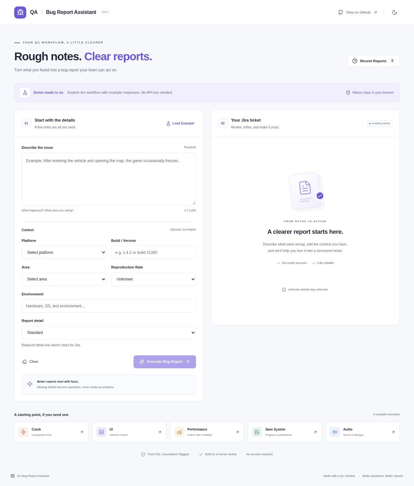
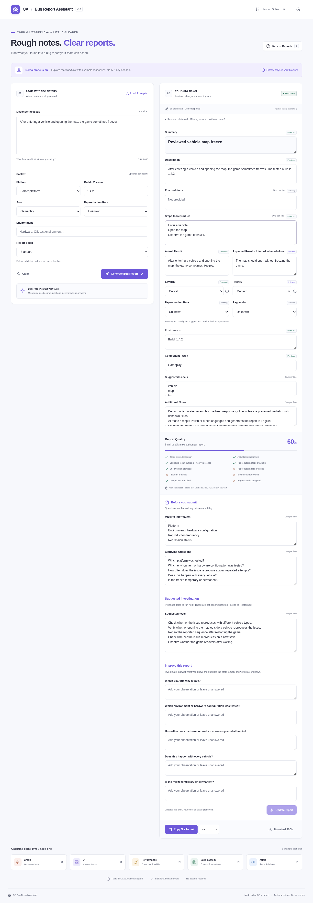
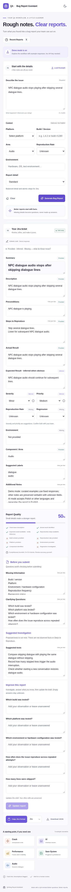
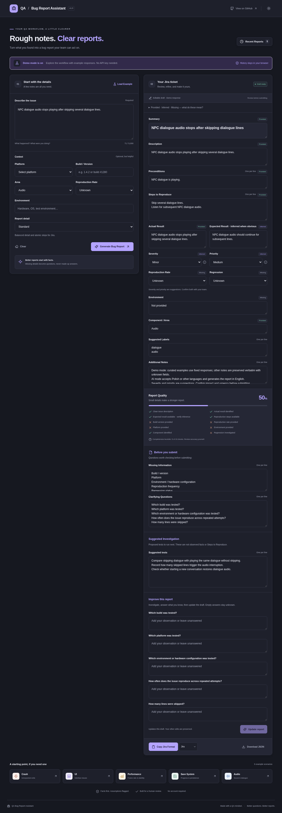
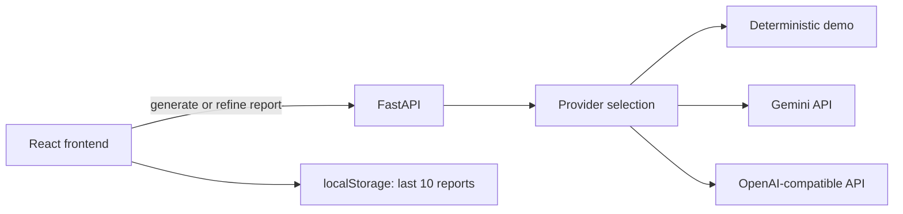

# QA Bug Report Assistant

Turn rough tester notes into a clear, editable Jira-ready bug report. Built for game QA workflows with a deliberate rule: **missing information stays missing**.

Tester notes can be written in English, Polish, or another language. In live AI mode, the final report is generated in professional English while technical identifiers are preserved.

## Why I Built This

Writing a useful defect report takes more than expanding a sentence. It means separating observations from assumptions, describing repeatable actions, and asking the right follow-up questions. This project explores how AI can support that workflow without replacing tester judgment.

## Features

- Structured reports: summary, description, preconditions, repro steps, actual/expected result, reproduction rate, severity, priority, environment, component, regression, labels, notes, missing information, and clarifying questions.
- Polish or other non-English tester notes can be converted into an English QA report in live AI mode.
- Generate → answer clarifying questions → update the same editable report, preserving the investigation workflow.
- Provided / Inferred / Missing badges show the source of each key field.
- Compact, Standard (default), and Detailed reports control wording without creating facts.
- Suggested Investigation proposes relevant next tests separately from observed facts and reproduction steps.
- Every generated field, including suggested investigation, remains editable before export.
- Severity and priority are separate suggestions.
- Gemini API support as the recommended provider, with an OpenAI-compatible provider as an optional alternative.
- Deterministic offline Demo Mode requiring no API key.
- Strict server-side Pydantic validation and client-side Zod validation.
- Jira wiki markup, Markdown, plain text, and JSON export.
- Recent Reports stored locally in the browser (maximum 10).
- Responsive UI, light/dark themes, keyboard support, loading/error states, and accessibility checks.
- Automated backend, frontend, browser, and CI checks.

## Screenshots



<details>
<summary>Generated report, mobile, and dark mode</summary>






</details>

## Example

**Tester note (Polish)**

> Po wejściu do samochodu i otwarciu mapy gra czasami się zawiesza.

**Live AI output (English)**

```text
Summary: Game sometimes freezes when opening the map inside a vehicle

Steps to Reproduce:
1. Enter a vehicle.
2. Open the map.
3. Observe the game behavior.

Actual Result:
The game sometimes freezes after opening the map inside a vehicle.

Expected Result:
The map should open without freezing the game.
```

Unknown build, platform, environment, reproduction frequency, or regression status remain unknown and are surfaced as missing information / follow-up questions instead of being invented.

## Improve a Report

The workflow is **tester observes → AI structures → AI identifies gaps → tester investigates → AI updates report → tester reviews and submits**. This is an assistant for a tester, not an automated source of facts or a replacement for review.

1. Select **Report detail**, enter observations and any known metadata, and generate.
2. Review the editable report, provenance badges, missing information, and proposed investigation.
3. In **Improve this report**, answer the questions you can resolve. Unanswered fields are optional.
4. Click **Update report**. The backend receives the original notes/metadata, the current edited ticket, and the nonempty question/answer pairs.
5. Review the updated draft and export. Refinement updates the same history entry rather than creating duplicate reports. Answer drafts are saved locally, too.

For the Polish vehicle/map note above, the initial report identifies missing build and reproduction frequency. Enter:

```text
Which build was tested?
Build 0.8.24

How often does the issue reproduce across repeated attempts?
Happens around 3 out of 5 attempts.
```

The updated report contains `Build: 0.8.24` in Environment and `3/5` in Reproduction Rate with **Provided** provenance. The approximate wording is preserved in the tester-answer notes. Those two gaps and questions disappear; unanswered platform/environment/regression gaps stay unresolved. A manually edited title, severity/priority, notes, labels, and reproduction steps remain part of the current report supplied for refinement. Demo refinement preserves unrelated fields exactly; live providers are instructed to preserve edits and verified facts and still require human review.

Empty answers are ignored by the client and backend. A request with no nonempty answers returns the existing report without a provider call. Unknown or ambiguous answers must not become negative results or made-up numeric rates. Updating failures leave the current draft and answers visible so the tester can retry or export.

### Provided, Inferred, Missing

| Badge | Meaning | Example |
| --- | --- | --- |
| Provided | Directly supported by tester notes, metadata, follow-up answers, or a manual edit. Translation/rewording is still Provided. | `gra się zawiesza` → `The game freezes`; build supplied in a follow-up |
| Inferred | An obvious expectation, category, or reviewable assessment derived from the observations. | Expected Result: opening the map should not freeze the game; suggested severity/priority |
| Missing | Information is absent or unknown. Unknown never means No. | Unknown reproduction rate or regression status |

A `provenance` object records these statuses for summary, description, preconditions, steps, actual/expected result, reproduction rate, severity, priority, environment, component, and regression. A mixed-source field is marked Inferred if it contains a material inference. Editing a key field marks its new content Provided; clearing it marks it Missing. Provided describes a source, not independently verified truth. The UI has an expandable legend; the labels and schema cannot guarantee factual accuracy.

Older saved reports remain readable. Their provenance was never recorded, so the UI hides estimated compatibility metadata rather than presenting it as known evidence. Regenerate a legacy ticket to obtain a fresh set of field labels. The local history limit remains ten.

### Suggested Investigation

`suggestedInvestigation` normally contains 3–6 relevant tests to try next. These are proposals, not claims about what happened and not reproduction steps. For the map/vehicle example they include checking different vehicles, opening the map outside a vehicle, and observing whether the game recovers after waiting. This section is editable/removable and is exported separately in Jira, Markdown, and plain text. JSON also includes the provenance object.

### Report Detail

| Level | Intended wording | Evidence rule |
| --- | --- | --- |
| Compact | Usually 1–2 description sentences and short, complete steps | Keep all important supplied information |
| Standard (default) | Usually 2–4 sentences and atomic actions; a practical Jira default | Structure the available facts |
| Detailed | Usually 3–6 sentences and fuller supplied context | Sparse input stays short; no new facts to reach a length target |

Sentence counts are guides, not quotas. Demo mode can show shorter steps and add supplied build/platform/environment context at higher levels; it does not simulate unconstrained AI writing.

## AI Providers

The backend supports three modes:

1. **Gemini** — recommended for personal use and portfolio demos. Google currently offers a free tier for selected Gemini models, subject to current quotas, availability, and terms.
2. **OpenAI-compatible provider** — optional alternative using the existing Chat Completions integration.
3. **Demo Mode** — fully offline deterministic responses for predefined examples; no API key or paid service required.

With `QA_MODE=auto` and `QA_PROVIDER=auto`, provider selection is:

```text
Gemini key available -> Gemini
otherwise OpenAI-compatible key available -> OpenAI-compatible provider
otherwise -> Demo Mode
```

The frontend never receives provider API keys.

## Tech Stack

- **Frontend:** React 19, TypeScript strict mode, Vite, Tailwind CSS 4, Lucide icons, Zod.
- **Backend:** Python 3.12+, FastAPI, Pydantic, pydantic-settings, HTTPX.
- **AI:** Gemini GenerateContent API + optional OpenAI-compatible Chat Completions provider.
- **Quality:** Vitest, Testing Library, pytest, Playwright, axe, ESLint, Ruff, Prettier, GitHub Actions.
- **Storage:** localStorage only. No accounts or database.

## Architecture



`IssueInput` validates tester notes and metadata. Provider output must match the `Report` schema before it reaches the frontend. Gemini structured output and the OpenAI-compatible JSON schema mode are both validated again with Pydantic.

`POST /api/reports` accepts `IssueInput`, including `detailLevel` (`compact`, `standard`, `detailed`). `POST /api/reports/refine` accepts `{ originalInput, report, answers: [{ question, answer }] }`. Both return `{ report, mode }` and share the existing provider transports and structured-output validation. Refinement allows up to five question/answer pairs, 2,000 characters per answer, and rejects duplicate or unasked answered questions. Pydantic checks field bounds, provenance values and missing-value consistency; Zod checks response shapes and local history.

Gemini generation and refinement use the same existing transient-error retry/backoff. Provider failures remain explicit and never silently switch to a fabricated demo response. The OpenAI-compatible alternative and server-only credentials are preserved.

The system prompt is stored in `backend/app/system_prompt.txt`; `backend/app/refinement_prompt.txt` adds the follow-up preservation rules. It explicitly requires generated report fields to be written in English even when tester notes are Polish or another language.

## Windows Quick Start

After cloning or pulling the repository, Windows users can simply run:

```text
start.bat
```

If dependencies are not installed yet, `start.bat` runs `setup.bat` first. It then starts the FastAPI backend, starts the Vite frontend, and opens the app in the browser.

You can also run the first-time setup manually:

```text
setup.bat
```

## Configure Gemini (recommended)

Copy `.env.example` to `.env` in the repository root and add your Gemini API key:

```env
QA_MODE=auto
QA_PROVIDER=auto
QA_GEMINI_API_KEY=your_key_here
QA_GEMINI_MODEL=gemini-3.8-flash
```

Restart the backend / `start.bat` after changing `.env`.

A Gemini API key can be created in Google AI Studio. Keep the key private and never commit `.env` to GitHub. Free-tier availability and limits are controlled by Google and can change, so check the current Gemini API pricing and quota documentation before relying on it for a public deployment.

## Optional OpenAI-compatible Provider

If no Gemini key is configured, `QA_PROVIDER=auto` can use the existing OpenAI-compatible configuration:

```env
QA_MODE=auto
QA_PROVIDER=auto
QA_AI_API_KEY=your_key_here
QA_AI_BASE_URL=https://api.openai.com/v1
QA_AI_MODEL=gpt-4o-mini
```

To explicitly choose a provider:

```env
QA_PROVIDER=gemini
```

or:

```env
QA_PROVIDER=openai
```

Use `QA_MODE=ai` if you want missing live-provider configuration to be treated as an error rather than falling back to Demo Mode.

## Environment Variables

| Variable | Default | Purpose |
| --- | --- | --- |
| `QA_MODE` | `auto` | `auto`: live provider if configured, otherwise demo. `demo`: force offline. `ai`: require live AI. |
| `QA_PROVIDER` | `auto` | `auto`, `gemini`, or `openai`. Auto prefers Gemini. |
| `QA_GEMINI_API_KEY` | empty | Server-only Gemini API key. |
| `QA_GEMINI_BASE_URL` | Gemini v1beta API | Gemini API base URL. |
| `QA_GEMINI_MODEL` | `gemini-3.8-flash` | Gemini model used for report generation. |
| `QA_AI_API_KEY` | empty | Optional OpenAI-compatible API key. |
| `QA_AI_BASE_URL` | `https://api.openai.com/v1` | OpenAI-compatible API base URL. |
| `QA_AI_MODEL` | `gpt-4o-mini` | OpenAI-compatible model. |
| `QA_AI_TIMEOUT_SECONDS` | `30` | Provider timeout (1–120 seconds). |

## Manual Local Setup

Prerequisites: Node.js 22.12+, npm, Python 3.12+, and a browser.

```bash
python -m venv .venv
```

Windows PowerShell:

```powershell
.venv\Scripts\Activate.ps1
pip install -r backend\requirements.lock
npm --prefix frontend ci
```

Start the backend:

```powershell
cd backend
uvicorn app.main:app --host 127.0.0.1 --port 8000 --reload
```

Start the frontend from a second terminal in the repository root:

```powershell
npm --prefix frontend run dev
```

Open the address printed by Vite (normally `http://localhost:5173`).

## Demo Mode

With no provider key, `QA_MODE=auto` uses deterministic offline generation. Curated examples produce complete fixed reports. Arbitrary notes are intentionally preserved with unknown fields instead of being fabricated.

Offline refinement recognizes the built-in build, numeric rate (`3/5` or `3 out of 5`), platform, and environment questions. It updates only supported fields, preserves unrelated edits, and removes only resolved gaps/questions. Unrecognized answers are retained as quoted tester-answer evidence in Additional Notes; the unresolved gap remains. This is intentionally conservative. Unknown answers remain unknown. Unsupported free-form extraction, translation of arbitrary follow-up prose, and semantic interpretation of custom questions require a live provider. Very long/full reports can return a safe size-limit error instead of silently dropping evidence.

Demo Mode is not an offline language model and does not provide full translation/generation for arbitrary notes. Use Gemini or another configured live provider for that workflow.

## Testing

Backend:

```bash
(cd backend && ../.venv/bin/pytest -q)
(cd backend && ../.venv/bin/ruff check . && ../.venv/bin/ruff format --check .)
```

Frontend:

```bash
npm --prefix frontend test
npm --prefix frontend run lint
npm --prefix frontend run format:check
npm --prefix frontend run build
```

Browser tests:

```bash
(cd frontend && npx playwright install chromium)
QA_MODE=demo npm --prefix frontend run test:e2e
# Cloud image with installed system Chromium:
# PLAYWRIGHT_CHROMIUM_EXECUTABLE_PATH=/usr/bin/chromium QA_MODE=demo npm --prefix frontend run test:e2e
```

Tests use Demo Mode or mocked provider responses and require no paid API calls or real Gemini quota. Browser tests start the backend with `QA_MODE=demo`; stop an already running live backend before using server reuse. The browser suite includes generate → answer → refine → restore, plus accessibility checks. Local results and coverage limits are recorded in [docs/VALIDATION.md](docs/VALIDATION.md). The manual/exploratory QA matrix is documented in [docs/TEST_CASES.md](docs/TEST_CASES.md).

## Project Structure

```text
qa-bug-report-assistant/
├── frontend/
│   ├── src/
│   │   ├── components/
│   │   ├── lib/
│   │   └── test/
│   └── e2e/
├── backend/
│   ├── app/
│   │   ├── main.py
│   │   ├── models.py
│   │   ├── config.py
│   │   ├── providers.py
│   │   ├── demo.py
│   │   ├── refinement.py
│   │   ├── refinement_prompt.txt
│   │   └── system_prompt.txt
│   └── tests/
├── docs/
├── setup.bat
├── start.bat
├── .env.example
└── .github/workflows/ci.yml
```

## Development Note

AI-assisted development tools were used during implementation. The product concept, QA requirements, report rules, test scenarios, validation criteria, and final behavior were reviewed from a QA perspective.

## Future Improvements

1. Jira Cloud API integration with explicit preview and submission.
2. Custom project templates and team-specific severity/priority rules.
3. Attachment and screenshot analysis with provenance for extracted details.
4. Duplicate issue detection against an approved issue source.
5. Optional hosted demo with rate limiting and abuse protection.

## License

MIT. See [LICENSE](LICENSE).
