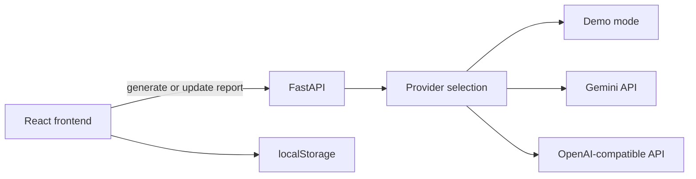

# QA Bug Report Assistant

[](https://github.com/kamilkownacki/qa-bug-report-assistant/actions/workflows/ci.yml)

A small QA tool for turning rough tester notes into structured, editable bug reports.

The main rule is simple: **if information was not provided, the app should not make it up**.

Tester notes can be written in Polish, English or another language. With a live provider configured, the report is returned in English while technical names and identifiers are kept as they were entered.

## Why I Built It

In manual QA, the difficult part of writing a good bug report is usually not the wording. It is separating what was actually observed from what is only assumed, making the steps clear and noticing what still needs to be checked.

I built this project around that workflow. The tool structures the notes, points out missing information and gives the tester a chance to fill in the gaps before exporting the report.

## Features

- Structured bug reports with summary, description, preconditions, steps, actual and expected result, reproduction rate, severity, priority, environment, component, regression status, labels and notes.
- Missing information is kept visible instead of being filled with guesses.
- Provided / Inferred / Missing labels show where each important field came from.
- Follow up questions can be answered and used to update the same report.
- Suggested Investigation lists useful checks separately from the reproduction steps.
- All generated fields stay editable.
- Severity and priority are handled separately.
- Compact, Standard and Detailed report modes.
- Jira wiki markup, Markdown, plain text and JSON export.
- Recent reports are stored locally in the browser.
- Light and dark themes, keyboard support and accessibility checks.
- Backend, frontend and browser tests run in CI.

## Screenshots


<details>
<summary>Generated report, mobile view and dark mode</summary>


</details>

## Example

**Tester note**

> Po wejściu do samochodu i otwarciu mapy gra czasami się zawiesza.

**Generated report**

```text
Summary: Game sometimes freezes when opening the map inside a vehicle

Steps to Reproduce:
1. Enter a vehicle.
2. Open the map.
3. Observe the game behavior.

Actual Result:
The game sometimes freezes after opening the map inside a vehicle.

Expected Result:
The map should open without freezing the game.
```

The note does not contain a build, platform, reproduction rate or regression status, so those fields stay unknown and are shown as missing information.

## Typical Workflow

1. Enter the tester notes and any metadata that is already known.
2. Generate a report.
3. Review the report and the missing information list.
4. Answer any follow up questions you can verify.
5. Update the report.
6. Make manual edits if needed.
7. Export it in the preferred format.

For example, if the tester later confirms build `0.8.24` and a reproduction rate of `3/5`, those values are added as provided information. Other unknown fields stay unknown.

## Provided, Inferred and Missing

| Label | Meaning | Example |
| --- | --- | --- |
| Provided | Comes directly from tester notes, metadata, follow up answers or a manual edit. | `gra się zawiesza` becomes `The game freezes`; build supplied later |
| Inferred | A reasonable expectation or assessment based on the notes, but not a directly observed fact. | Expected result or suggested severity |
| Missing | The information is not known. | Reproduction rate or regression status was not supplied |

Editing a key field marks the new value as Provided. Clearing it marks the field as Missing.

## Suggested Investigation

The app can suggest a few useful checks to try next. These are kept separate from the reproduction steps so they are not confused with things that have already been tested.

For the vehicle and map example, suggestions might include checking another vehicle, opening the map outside a vehicle or waiting to see if the game recovers.

## Report Detail

| Level | Intended use |
| --- | --- |
| Compact | Short report with the important facts kept intact |
| Standard | Default format for a normal Jira ticket |
| Detailed | More context when enough information was supplied |

The detail setting changes wording and structure. It should not create extra facts just to make the report longer.

## Providers and Demo Mode

The backend supports three modes:

1. **Gemini**: the main live provider used by the project.
2. **OpenAI-compatible provider**: optional alternative using the existing Chat Completions integration.
3. **Demo Mode**: deterministic offline responses for predefined examples. No API key is needed.

With `QA_MODE=auto` and `QA_PROVIDER=auto`, selection works like this:

```text
Gemini key available -> Gemini
otherwise OpenAI-compatible key available -> OpenAI-compatible provider
otherwise -> Demo Mode
```

Provider API keys stay on the backend and are not sent to the frontend.

## Tech Stack

- **Frontend:** React 19, TypeScript, Vite, Tailwind CSS 4, Zod
- **Backend:** Python 3.12+, FastAPI, Pydantic, HTTPX
- **Providers:** Gemini and an optional OpenAI-compatible endpoint
- **Testing:** Vitest, Testing Library, pytest, Playwright, axe
- **Code quality:** ESLint, Ruff, Prettier, GitHub Actions
- **Storage:** localStorage only, with no accounts or database

## Architecture



Provider responses are validated before they reach the frontend. The same applies to refinement requests and saved report data.

## Windows Quick Start

After cloning the repository, run:

```text
start.bat
```

If dependencies are missing, `start.bat` runs `setup.bat` first. It then starts the backend and frontend and opens the app in the browser.

You can also run the first setup manually:

```text
setup.bat
```

## Configure Gemini

Copy `.env.example` to `.env` in the repository root and add your API key:

```env
QA_MODE=auto
QA_PROVIDER=auto
QA_GEMINI_API_KEY=your_key_here
QA_GEMINI_MODEL=gemini-3.8-flash
```

Restart the backend after changing `.env`.

Keep `.env` private and never commit provider keys to GitHub.

## Optional OpenAI-compatible Provider

```env
QA_MODE=auto
QA_PROVIDER=auto
QA_AI_API_KEY=your_key_here
QA_AI_BASE_URL=https://api.openai.com/v1
QA_AI_MODEL=gpt-4o-mini
```

To force a specific provider:

```env
QA_PROVIDER=gemini
```

or:

```env
QA_PROVIDER=openai
```

Use `QA_MODE=ai` if you want missing live-provider configuration to return an error instead of using Demo Mode.

## Environment Variables

| Variable | Default | Purpose |
| --- | --- | --- |
| `QA_MODE` | `auto` | `auto`: live provider if configured, otherwise demo. `demo`: force offline. `ai`: require a live provider. |
| `QA_PROVIDER` | `auto` | `auto`, `gemini`, or `openai`. |
| `QA_GEMINI_API_KEY` | empty | Server-only Gemini API key. |
| `QA_GEMINI_BASE_URL` | Gemini v1beta API | Gemini API base URL. |
| `QA_GEMINI_MODEL` | `gemini-3.8-flash` | Gemini model used for report generation. |
| `QA_AI_API_KEY` | empty | Optional OpenAI-compatible API key. |
| `QA_AI_BASE_URL` | `https://api.openai.com/v1` | OpenAI-compatible API base URL. |
| `QA_AI_MODEL` | `gpt-4o-mini` | OpenAI-compatible model. |
| `QA_AI_TIMEOUT_SECONDS` | `30` | Provider timeout in seconds. |

## Manual Local Setup

Prerequisites: Node.js 22.12+, npm, Python 3.12+ and a browser.

```bash
python -m venv .venv
```

Windows PowerShell:

```powershell
.venv\Scripts\Activate.ps1
pip install -r backend\requirements.lock
npm --prefix frontend ci
```

Start the backend:

```powershell
cd backend
uvicorn app.main:app --host 127.0.0.1 --port 8000 --reload
```

Start the frontend from a second terminal:

```powershell
npm --prefix frontend run dev
```

Open the address printed by Vite, normally `http://localhost:5173`.

## Demo Mode

When no provider key is configured, `QA_MODE=auto` uses Demo Mode. It is deterministic and intended for local testing and portfolio use.

Known demo examples return fixed reports. Arbitrary notes are kept conservative, with unknown fields left empty instead of guessed.

Demo refinement supports the built in questions for build, reproduction rate, platform and environment. More open ended interpretation requires a live provider.

## Testing

Backend:

```bash
(cd backend && ../.venv/bin/pytest -q)
(cd backend && ../.venv/bin/ruff check . && ../.venv/bin/ruff format --check .)
```

Frontend:

```bash
npm --prefix frontend test
npm --prefix frontend run lint
npm --prefix frontend run format:check
npm --prefix frontend run build
```

Browser tests:

```bash
(cd frontend && npx playwright install chromium)
QA_MODE=demo npm --prefix frontend run test:e2e
```

Tests use Demo Mode or mocked provider responses, so they do not need a paid API call. The browser suite covers generation, refinement, restoring reports and accessibility checks.

More detail is available in [docs/VALIDATION.md](docs/VALIDATION.md) and [docs/TEST_CASES.md](docs/TEST_CASES.md).

## Project Structure

```text
qa-bug-report-assistant/
├── frontend/
│   ├── src/
│   └── e2e/
├── backend/
│   ├── app/
│   └── tests/
├── docs/
├── setup.bat
├── start.bat
├── .env.example
└── .github/workflows/ci.yml
```

## Development Note

I used AI tools for parts of the implementation and documentation. The idea, QA rules, test scenarios, validation and final behaviour were reviewed manually from a tester's point of view.

## Possible Next Steps

1. Jira Cloud integration with a preview before submission.
2. Project specific templates and severity rules.
3. Screenshot and attachment analysis.
4. Duplicate issue checks against an approved issue source.
5. A hosted demo with rate limiting.

## License

MIT. See [LICENSE](LICENSE).
